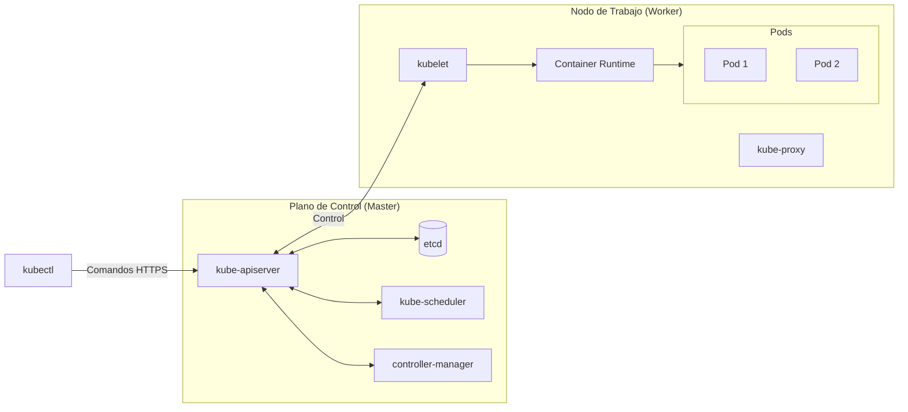

# ☸️ Kubernetes (K8s) – Guía y Prácticas de Laboratorio

[](https://kubernetes.io/)
[](https://minikube.sigs.k8s.io/)
[](https://www.docker.com/)
[](https://www.kernel.org/)
[](https://github.com/eljoviz/kubernetes)

Repositorio de formación técnica, apuntes y casos prácticos de laboratorio sobre orquestación de contenedores y despliegue de infraestructuras con **Kubernetes (K8s)**.

---

## 📋 Índice de Contenidos

Haz clic en cualquiera de los apartados para acceder a su documentación completa con teoría, diagramas y comandos prácticos paso a paso:

| # | Apartado | Descripción y Conceptos Clave | Documento |
| :-: | :--- | :--- | :-: |
| **1** | **Introducción a Kubernetes** | Qué es K8s, diferencias con Docker individual, arquitectura de clúster (*Control Plane* vs *Worker Nodes*) y paradigma declarativo YAML. | [📖 Ver Apartado 1](docs/01-introduccion.md) |
| **2** | **Instalación del Entorno** | Requisitos previos, instalación de la CLI oficial `kubectl`, arranque de clúster local con **Minikube** y comprobación de nodos. | [📖 Ver Apartado 2](docs/02-instalacion.md) |
| **3** | **Pods** | Unidad básica de cómputo, compartición de red e IP, creación imperativa (`run`) y declarativa (YAML), ciclo de vida e inspección. | [📖 Ver Apartado 3](docs/03-pods.md) |
| **4** | **ReplicaSets** | Controlador de disponibilidad, selección por etiquetas (`matchLabels`), prueba de autocuración (*Self-Healing*) y escalado de réplicas. | [📖 Ver Apartado 4](docs/04-replica-sets.md) |
| **5** | **Deployments** | Gestión avanzada de aplicaciones, actualizaciones progresivas (*Rolling Updates*) sin caída de servicio, historial de versiones y *Rollback*. | [📖 Ver Apartado 5](docs/05-deployments.md) |

---

## 🏛️ Arquitectura General



---

## 📁 Estructura del Repositorio

El repositorio se organiza siguiendo las mejores prácticas de documentación modular:

```text
kubernetes/
├── README.md               # Portada principal e índice navegable del repositorio
├── docs/                   # Carpeta técnica con los temas desarrollados
│   ├── 01-introduccion.md  # 1. Introducción, conceptos y arquitectura
│   ├── 02-instalacion.md   # 2. Instalación de kubectl y Minikube
│   ├── 03-pods.md          # 3. Gestión y ciclo de vida de Pods
│   ├── 04-replica-sets.md  # 4. Controladores de réplicas y Self-Healing
│   └── 05-deployments.md   # 5. Despliegues continuos, Rolling Updates y Rollback
├── img/                    # Esquemas visuales y diagramas de arquitectura
│   ├── .gitkeep
│   └── arquitectura_k8s.svg
└── LICENSE                 # Licencia de código abierto GPLv3
```

---

## ⚡ Chuleta Rápida de Comandos Esenciales

```bash
# Nodos y Clúster
kubectl cluster-info
kubectl get nodes -o wide

# Pods
kubectl run mi-pod --image=nginx:alpine
kubectl get pods -o wide
kubectl describe pod <nombre-pod>
kubectl logs <nombre-pod> -f
kubectl exec -it <nombre-pod> -- sh
kubectl delete pod <nombre-pod>

# ReplicaSets y Deployments
kubectl apply -f <archivo.yaml>
kubectl get deployments,replicasets,pods
kubectl scale deployment/<nombre> --replicas=5
kubectl rollout status deployment/<nombre>
kubectl rollout history deployment/<nombre>
kubectl rollout undo deployment/<nombre>
```

---

## 👤 Autor
* **Alumno:** Jose Vizuete González
* **Ciclo:** 2º Curso – C.F.G.S. Administración de Sistemas Informáticos en Red (ASIR)
* **Repositorio GitHub:** [https://github.com/eljoviz/kubernetes](https://github.com/eljoviz/kubernetes)
