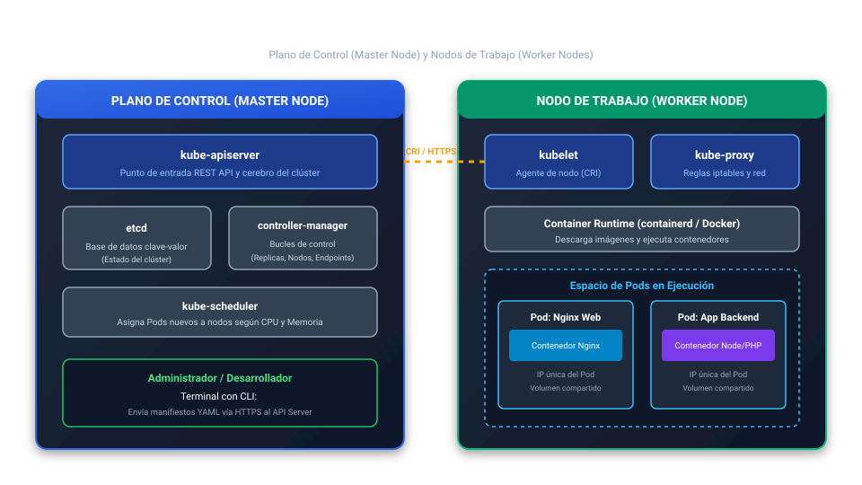

# 1. Introducción a Kubernetes (K8s)

## 1.1 ¿Qué es Kubernetes?
**Kubernetes** (abreviado comúnmente como **K8s**, ya que hay 8 letras entre la 'K' y la 's') es una plataforma de código abierto diseñada originalmente por **Google** (basada en su sistema interno *Borg*) y donada a la **Cloud Native Computing Foundation (CNCF)**.

Su objetivo principal es la **automatización del despliegue, escalado, balanceo de carga y gestión del ciclo de vida de aplicaciones en contenedores**.

---

## 1.2 El problema que resuelve: Docker vs Kubernetes

| Aspecto | Docker (Standalone) | Kubernetes (Orquestador) |
| :--- | :--- | :--- |
| **Ámbito de ejecución** | Un único servidor (host físico o VM). | Un clúster de múltiples servidores coordinados. |
| **Caída de contenedores** | Requiere reinicio manual o políticas simples (`restart: always`). | **Autoreparación (*Self-Healing*):** Reemplaza y reinicia contenedores caídos al instante. |
| **Caída de un servidor físico** | Todos los contenedores de ese servidor mueren y quedan offline. | Detecta el fallo del nodo y **reubica los contenedores automáticamente** en nodos sanos. |
| **Escalado de tráfico** | Manual (`docker compose up --scale app=5` en el mismo host). | **Escalado dinámico y automático (*HPA*):** Añade réplicas según consumo de CPU/RAM. |
| **Actualizaciones de software** | Requiere parar el contenedor viejo y levantar el nuevo (corte de servicio). | **Actualizaciones continuas (*Rolling Updates*):** Cero tiempo de inactividad (*Zero Downtime*). |
| **Descubrimiento y balanceo** | Requiere configurar proxies externos manuales (Nginx/Traefik). | **Servicios integrados:** DNS interno y balanceo de carga L4 nativo entre réplicas. |

---

## 1.3 Arquitectura de un Clúster de Kubernetes

Un clúster de Kubernetes está formado por dos roles de máquinas:

### 1. Plano de Control (*Control Plane* / Nodo Maestro)
Es el "cerebro" del clúster y toma las decisiones globales (planificación, detección de eventos, balanceo):
* **`kube-apiserver`:** Punto central de entrada. Expone la API REST de Kubernetes y procesa todas las órdenes (procedentes de `kubectl`, scripts o interfaces gráficas). Valida y configura los datos de los objetos.
* **`etcd`:** Base de datos distribuida, consistente y altamente disponible de tipo clave-valor. Almacena el estado completo de configuración y salud del clúster.
* **`kube-scheduler`:** Planificador que vigila los Pods recién creados que no tienen nodo asignado y selecciona el mejor nodo de trabajo para ejecutarlos basándose en recursos libres (CPU, RAM), afinidades y restricciones.
* **`kube-controller-manager`:** Ejecuta bucles de control continuos que comparan el estado real del clúster con el estado deseado. Incluye:
  * *Node Controller:* Detecta y responde ante caídas de nodos.
  * *ReplicaSet Controller:* Asegura el número correcto de Pods.
  * *Endpoints Controller:* Une Services con Pods.
  * *ServiceAccount Controller:* Crea cuentas y tokens de acceso por defecto.

### 2. Nodos de Trabajo (*Worker Nodes*)
Son los servidores donde realmente se ejecutan las aplicaciones en contenedores:
* **`kubelet`:** Agente que corre en cada nodo. Asegura que los contenedores descritos en los *PodSpecs* estén corriendo y funcionando correctamente mediante la interfaz estándar CRI (*Container Runtime Interface*).
* **`kube-proxy`:** Mantiene las reglas de red (iptables / IPVS) en los nodos para permitir la comunicación por red con los Pods desde dentro y fuera del clúster.
* **`Container Runtime`:** El software encargado de descargar imágenes y ejecutar los contenedores (`containerd`, `CRI-O`).

---

## 1.4 Paradigma Declarativo vs Imperativo

Kubernetes trabaja bajo el principio de **Gestión Declarativa del Estado**:
* **Enfoque Imperativo ("CÓMO"):** Se le ordenan comandos individuales paso a paso (ej. *"Crea un contenedor, añade 2 réplicas, cambia el puerto"*). Si la máquina se reinicia, hay que repetir las órdenes.
* **Enfoque Declarativo ("QUÉ"):** Se define el **estado deseado** en archivos de texto estructurado en formato **YAML**. El administrador le dice a K8s: *"Quiero 3 réplicas de Nginx escuchando en el puerto 80"*. Kubernetes se encarga de manera continua y autónoma de mantener ese estado exacto, recuperándose de cualquier fallo sin intervención humana.

---
[⬅️ Volver al Índice Principal](../README.md) | [Siguiente: 2. Instalación ➡️](02-instalacion.md)
