# 2. Instalación de Minikube y `kubectl`

Guía paso a paso de la instalación y puesta en marcha de un clúster local de Kubernetes (**Minikube** v1.39.0 sobre **VirtualBox** con Kubernetes v1.37.0 y **kubectl** v1.37.2) en Ubuntu.

---

## 1. Instalación y arranque de Minikube

### Paso 1: Descargar el binario de Minikube
Descargamos la última versión oficial compilada para arquitectura `amd64`:

```bash
curl -LO https://github.com/kubernetes/minikube/releases/latest/download/minikube-linux-amd64
```

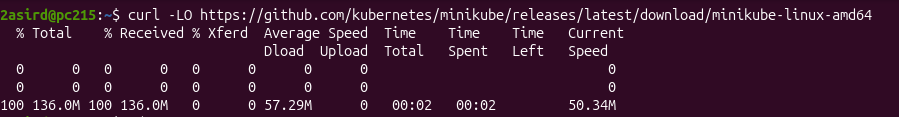

### Paso 2: Instalar el binario en el sistema
Instalamos el ejecutable en `/usr/local/bin/minikube` para poder invocarlo desde cualquier ruta:

```bash
sudo install minikube-linux-amd64 /usr/local/bin/minikube
```

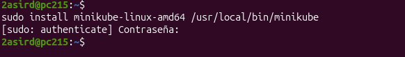

### Paso 3: Comprobar la versión instalada
Verificamos que `minikube` responde correctamente (`v1.39.0`):

```bash
minikube version
```

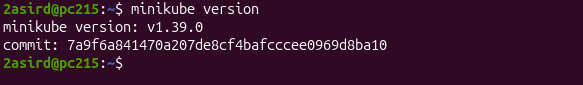

### Paso 4: Iniciar el clúster (`minikube start`)
Arrancamos el clúster. Minikube selecciona automáticamente el controlador **VirtualBox**, descarga la ISO y prepara Kubernetes `v1.37.0` sobre `containerd`:

```bash
minikube start
```

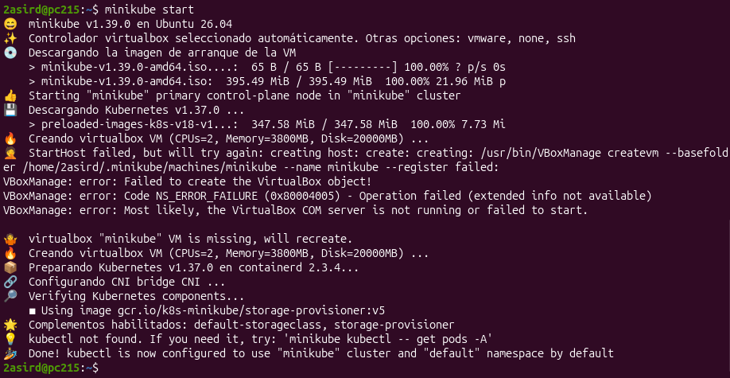

### Paso 5: Verificar el estado y perfil del clúster
Comprobamos que el plano de control (`host`, `kubelet` y `apiserver`) está en ejecución (`Running`) y `kubeconfig` configurado:

```bash
minikube status
```

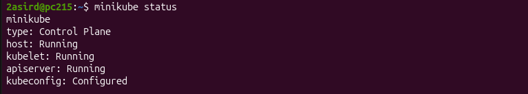

Listamos el perfil activo para verificar su IP (`192.168.59.100`), driver (`virtualbox`) y runtime (`containerd`):

```bash
minikube profile list
```

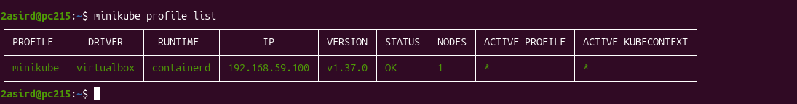

---

## 2. Instalación y verificación de `kubectl`

### Paso 6: Descargar el binario de `kubectl`
Descargamos la última versión estable de la CLI oficial de Kubernetes:

```bash
curl -LO "https://dl.k8s.io/release/$(curl -L -s https://dl.k8s.io/release/stable.txt)/bin/linux/amd64/kubectl"
```

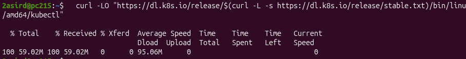

### Paso 7: Instalar `kubectl` y comprobar versiones
Instalamos el binario con permisos de ejecución y verificamos la versión tanto del cliente (`v1.37.2`) como del servidor (`v1.37.0`):

```bash
sudo install -o root -g root -m 0755 kubectl /usr/local/bin/kubectl
kubectl version
```

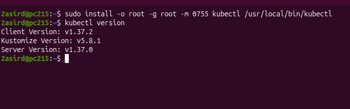

### Paso 8: Comprobar el nodo del clúster
Verificamos que el nodo `minikube` aparece en estado **`Ready`** con rol `control-plane`:

```bash
kubectl get nodes -o wide
```

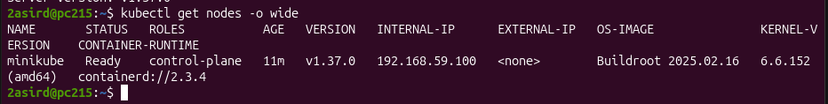

---

## 3. Activación del autocompletado de comandos

### Paso 9: Instalar `bash-completion`
Nos aseguramos de tener instalado el paquete de autocompletado en Ubuntu:

```bash
sudo apt install -y bash-completion
```

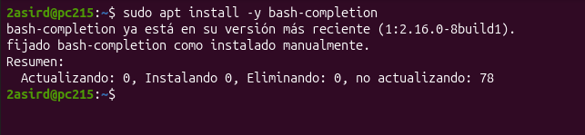

### Paso 10: Añadir autocompletado de `kubectl` y `minikube` a `~/.bashrc`
Agregamos las instrucciones de autocompletado al fichero de configuración de Bash para que queden permanentes:

```bash
echo 'source <(kubectl completion bash)' >> ~/.bashrc
echo 'source <(minikube completion bash)' >> ~/.bashrc
```

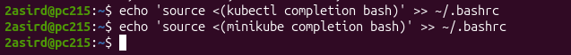

### Paso 11: Recargar la configuración de Bash
Aplicamos los cambios en la sesión actual de terminal sin necesidad de cerrarla:

```bash
source ~/.bashrc
```

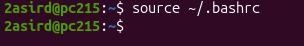

### Paso 12: Probar el autocompletado
Escribimos `minikube ` y pulsamos la tecla **Tabulador** dos veces para confirmar que sugiere todos los subcomandos disponibles:

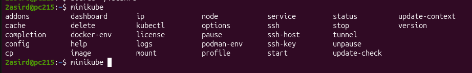

---
[⬅️ 1. Introducción](01-introduccion.md) | [Volver al Índice](../README.md) | [Siguiente: 3. Pods ➡️](03-pods.md)
