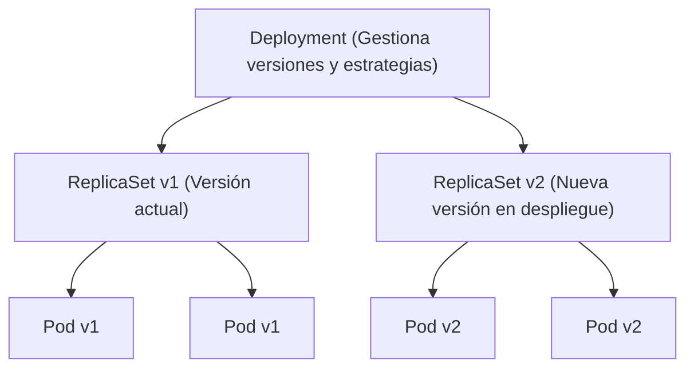

# 5. Deployments en Kubernetes

## 5.1 ¿Qué es un Deployment?
Un **Deployment** es un objeto de nivel superior en Kubernetes que **gestiona de forma automatizada y declarativa los ReplicaSets y los Pods**.

Es el estándar de facto en la industria para desplegar aplicaciones sin estado (*stateless applications*).



---

## 5.2 Ventajas Cruciales frente a ReplicaSets puros

1. **Actualizaciones sin caída (*Rolling Updates*):** Permite pasar de una versión `v1.0` a una `v2.0` sustituyendo los Pods de uno en uno de forma progresiva. El usuario nunca experimenta un corte de servicio (*Zero Downtime*).
2. **Historial de Revisiones (*Rollout History*):** Registra cada cambio realizado sobre el despliegue.
3. **Reversión Instantánea (*Rollback*):** Si la nueva versión contiene un bug o no arranca, se puede revertir a la versión anterior con un solo comando en menos de 2 segundos.
4. **Pausa y Reanudación:** Posibilidad de pausar el despliegue para aplicar múltiples cambios de configuración y reanudarlo al final.

---

## 5.3 Manifiesto YAML de un Deployment

Crea un archivo llamado `deployment-app.yaml`:

```yaml
apiVersion: apps/v1
kind: Deployment
metadata:
  name: deployment-nginx
  labels:
    app: mi-portal-web
spec:
  # 1. NÚMERO DE RÉPLICAS
  replicas: 4

  # 2. ESTRATEGIA DE ACTUALIZACIÓN PROGRESIVA
  strategy:
    type: RollingUpdate
    rollingUpdate:
      maxSurge: 1        # Máximo de Pods extra creados durante la actualización
      maxUnavailable: 0  # Garantiza que el 100% de los Pods deseados estén siempre activos

  # 3. SELECTOR DE ETIQUETAS
  selector:
    matchLabels:
      app: mi-portal-web

  # 4. PLANTILLA DEL POD
  template:
    metadata:
      labels:
        app: mi-portal-web
    spec:
      containers:
        - name: nginx-contenedor
          image: nginx:1.24-alpine
          ports:
            - containerPort: 80
          resources:
            requests:
              cpu: "50m"
              memory: "64Mi"
            limits:
              cpu: "150m"
              memory: "128Mi"
```

Aplicar el Deployment:
```bash
kubectl apply -f deployment-app.yaml
```

---

## 5.4 Operaciones y Ciclo de Vida con Deployments

### 1. Comprobar el estado del despliegue:
```bash
kubectl get deployments
kubectl get replicasets
kubectl get pods -l app=mi-portal-web
```

### 2. Actualización continua (*Rolling Update*) en caliente:
Vamos a actualizar la versión de Nginx de la `1.24-alpine` a la `1.25-alpine`:

```bash
kubectl set image deployment/deployment-nginx nginx-contenedor=nginx:1.25-alpine --record
```

Comprobar el progreso de la actualización:
```bash
kubectl rollout status deployment/deployment-nginx
```

Observa cómo Kubernetes va levantando los Pods nuevos y apagando los viejos gradualmente:
```bash
kubectl get pods -l app=mi-portal-web -w
```

### 3. Consultar el historial de versiones:
```bash
kubectl rollout history deployment/deployment-nginx

# Salida:
# REVISION  CHANGE-CAUSE
# 1         <none>
# 2         kubectl set image deployment/deployment-nginx nginx-contenedor=nginx:1.25-alpine --record=true
```

### 4. Reversión (*Rollback*) a una versión anterior:
Si detectamos un problema en la versión 1.25, volvemos a la versión anterior de forma inmediata:

```bash
# Revertir a la versión inmediatamente anterior
kubectl rollout undo deployment/deployment-nginx

# O bien revertir a una revisión histórica concreta:
kubectl rollout undo deployment/deployment-nginx --to-revision=1
```

### 5. Escalado de réplicas:
```bash
kubectl scale deployment deployment-nginx --replicas=6
```

---

## 5.5 Tabla Comparativa Final de Objetos

| Característica | Pod | ReplicaSet | Deployment |
| :--- | :---: | :---: | :---: |
| **Nivel Jerárquico** | Nivel 1 (Básico) | Nivel 2 (Controlador de cantidad) | Nivel 3 (Gestor de ciclo de vida) |
| **Garantiza réplicas activas** | ❌ No | ✅ Sí | ✅ Sí (mediante ReplicaSet) |
| **Autoreparación (*Self-Healing*)** | ❌ No | ✅ Sí | ✅ Sí |
| **Escalado manual en caliente** | ❌ No | ✅ Sí | ✅ Sí |
| **Rolling Update sin caída de servicio** | ❌ No | ❌ No | ✅ **Sí** |
| **Historial y marcha atrás (*Rollback*)** | ❌ No | ❌ No | ✅ **Sí** |
| **Uso recomendado en producción** | Solo depuración/Jobs | Casi nunca directo | **Estándar Oficial Recomendado** |

---
[⬅️ 4. ReplicaSets](04-replica-sets.md) | [Volver al Índice](../README.md)
